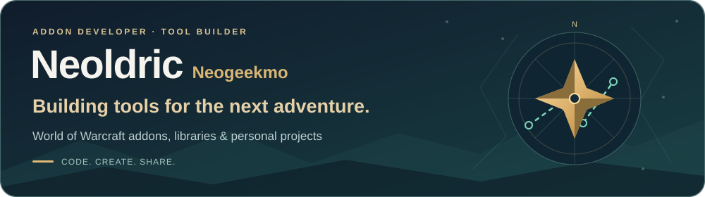

  <picture>
    <source media="(max-width: 600px)" srcset="assets/neoldric-banner-mobile-v2.svg">
    
  </picture>

<h1 align="center">Hi, I'm Neoldric 👋</h1>

  Previously known as <strong>Neogeekmo</strong>. 
  I develop <strong>WoW addons</strong>, reusable libraries, and tools that make everyday tasks easier. 
  My main focus is <strong>Azeroth Pilot Reloaded</strong>, alongside personal projects and open-source exploration.

  <strong>Lua &nbsp;·&nbsp; WoW APIs &nbsp;·&nbsp; Python &nbsp;·&nbsp; UI &amp; developer tooling</strong>

  <a href="#azeroth-pilot-reloaded">Azeroth Pilot Reloaded</a> &nbsp;·&nbsp;
  <a href="#the-apr-toolbox">APR toolbox</a> &nbsp;·&nbsp;
  <a href="#other-projects">Other projects</a> &nbsp;·&nbsp;
  <a href="#lets-connect">Let's connect</a>

---

## Azeroth Pilot Reloaded

  

<h3 align="center">Your adventure. A clear path.</h3>

  A quest routing and leveling addon for <strong>World of Warcraft</strong>. 
  Built on the Azeroth Auto Pilot legacy, and developed with the APR team and community. 
  I work on the addon, its interface, and the tools around it.

<table>
  <tr>
    <td width="33%" valign="top">
      <h3>🧭 Guided adventures</h3>
      
Waypoint navigation, map markers, and clear objectives to keep your journey moving.

    </td>
    <td width="33%" valign="top">
      <h3>🗺️ Flexible routes</h3>
      
Choose a route, build a custom path, and follow steps adapted to your character.

    </td>
    <td width="33%" valign="top">
      <h3>⚙️ A smoother experience</h3>
      
Configurable quest automation and an interface you can adjust to your playstyle.

    </td>
  </tr>
</table>

  

  <a href="https://github.com/Azeroth-Pilot-Reloaded/azeroth-pilot-reloaded/wiki">Read the wiki</a> &nbsp;·&nbsp;
  <a href="https://github.com/Azeroth-Pilot-Reloaded/azeroth-pilot-reloaded/issues">Report a bug or suggest an idea</a>

## The APR toolbox

<table>
  <tr>
    <td width="50%" valign="top">
      
      <h3>APR Route Recorder</h3>
      
<strong>Record your journey. Create your route.</strong>

      
A companion addon for APR. Capture questing steps, refine them in a visual workshop or Lua editor, and share custom routes with the community.

      
<a href="https://github.com/Azeroth-Pilot-Reloaded/APR-Route-Recorder">Explore the source →</a> <a href="https://www.curseforge.com/wow/addons/azeroth-pilot-reloaded-route-recorder">Download on CurseForge</a>

    </td>
    <td width="50%" valign="top">
      
      <h3>LibTaxiData</h3>
      
<strong>Every flight. The right connection.</strong>

      
A standalone addon and shared API for flight-master data: localized names, coordinates, character requirements, and navigation helpers for other addons.

      
<a href="https://github.com/Azeroth-Pilot-Reloaded/LibTaxiData">Explore the source →</a> <a href="https://www.curseforge.com/wow/addons/libtaxidata">Download on CurseForge</a>

    </td>
  </tr>
</table>

---

## Other projects

  

### SV Cleaner

**Your data. A clearer interface.**

A WoW addon and local Python companion for exploring, comparing, and cleaning **SavedVariables**. Inspect addon data in game, review changes, then use the companion to back up and apply them while WoW is closed.

[Explore SV Cleaner →](https://github.com/Neogeekmo/SVCleaner)

  <a href="https://github.com/Neogeekmo?tab=repositories&amp;type=source"><strong>Browse my other projects →</strong></a>

---

## Let's connect

Have an idea for an addon, found a bug, or want to help with routes or translations? Join the [APR community on Discord](https://discord.gg/YgcdybKdWX), or open an issue in the relevant project.

  <strong>Support the APR adventure</strong> 
  <a href="https://www.patreon.com/AzerothPilotReloaded">Patreon</a> &nbsp;·&nbsp;
  <a href="https://www.paypal.com/paypalme/neogeekmo">PayPal</a>

  Built for the community, one project at a time.

